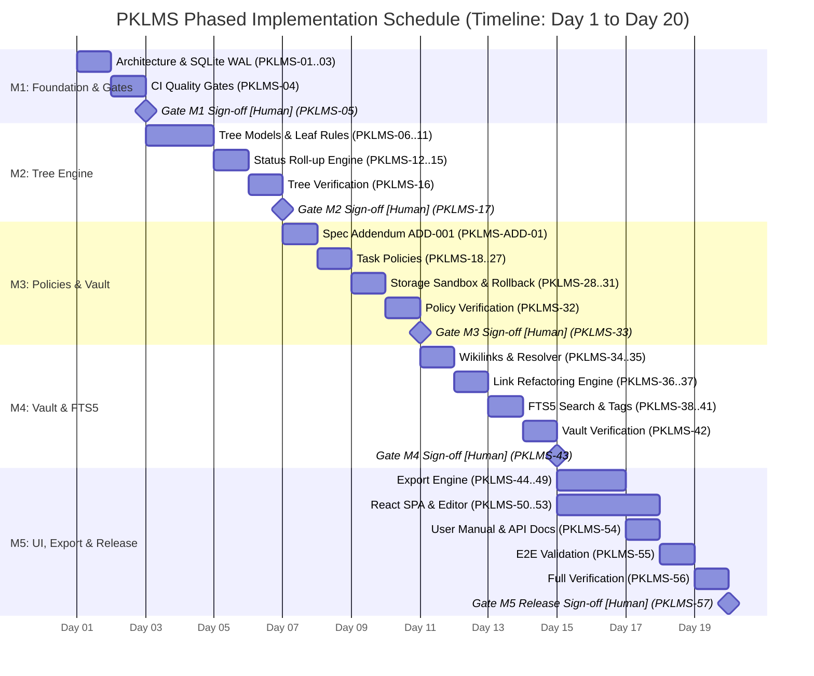

# PKLMS Master Implementation Plan & Governance Register

| Parameter | Governance Specification |
| :--- | :--- |
| **System** | Personal Knowledge & Learning Management System (PKLMS) |
| **Governing Specification** | [`spec/srs.md`](../spec/srs.md) (v0.2.1-draft) |
| **Workflow Protocol** | [`docs/workflow.md`](workflow.md) |
| **Development Discipline** | Specification-Driven Development (SDD) with Mandatory TDD |
| **Document Target** | `docs/implementation_plan.md` |
| **Author / Systems Architect** | Lead System Analyst & Architect / Maksym Korniienko (KN-32) |
| **Status** | Approved Master Implementation Plan (Post-SRS Baseline Approval) |

---

## 1. Executive Summary & Purpose

This document operationalizes the approved Software Requirements Specification ([`spec/srs.md`](../spec/srs.md)) into an actionable, verifiable, and traceably bound implementation plan. It establishes:
1. **Master Traceability Matrix**: Direct 1-to-1 linkage from requirements to tickets, test suites, and production code modules.
2. **Human vs. Agent Role Division (RACI)**: Formal boundaries ensuring cognitive sovereignty and eliminating unauthorized autonomous code execution.
3. **Phased WBS & Ticket Schedule**: Breakdown of 58 discrete tickets across five sequential milestones.
4. **Schedule Representation & Critical Path**: Gantt chart, bottleneck analysis, and separate estimation of human-performed activities.
5. **Comprehensive Risk Register**: Assessment and mitigation strategies for both traditional software risks and AI coding agent risks.
6. **Enhanced Oversight Gates Strategy**: Dedicated validation gates for high cost-of-failure architectural components.

---

## 2. Master Traceability Matrix

Every requirement from `spec/srs.md` is bound to its BDD acceptance scenario, automated test ID, planned target module, and implementation tickets.

| Requirement ID | Requirement Summary | Acceptance ID | BDD Scenario ID | Planned Test ID | Planned Target Module | Test Ticket | Feature Ticket | Spec Section |
| :--- | :--- | :--- | :--- | :--- | :--- | :---: | :---: | :--- |
| **`REQ-TREE-001`** | Recursive Goal/Module/Task CRUD | `ACCEPT-TREE-001` | `SCEN-TREE-001` | `TEST-UNIT-TREE-01` | `services/tree_service.py` | `PKLMS-06` | `PKLMS-07` | §5.3, §6.1 |
| **`REQ-TREE-002`** | Strict leaf task constraint (No mixed nodes) | `ACCEPT-TREE-002` | `SCEN-TREE-002` | `TEST-UNIT-TREE-02` | `models/node.py` | `PKLMS-08` | `PKLMS-09` | §6.1 |
| **`REQ-TREE-003`** | Max nesting depth $\le 5$ levels | `ACCEPT-TREE-003` | `SCEN-TREE-003` | `TEST-UNIT-TREE-03` | `services/tree_service.py` | `PKLMS-10` | `PKLMS-11` | §6.1 |
| **`REQ-TREE-004`** | Deterministic status roll-up algorithm | `ACCEPT-TREE-004` | `SCEN-TREE-004` | `TEST-UNIT-TREE-04` | `services/tree_service.py` | `PKLMS-12` | `PKLMS-13` | §6.3 |
| **`REQ-TREE-005`** | Catalog mode on 100% progress & revocation | `ACCEPT-TREE-005` | `SCEN-TREE-005` | `TEST-INT-TREE-01`  | `api/routers/goals.py` | `PKLMS-14` | `PKLMS-15` | §8.1 |
| **`REQ-POLICY-001`**| READING task manual acknowledgment | `ACCEPT-POLICY-001`| `SCEN-POLICY-001`| `TEST-UNIT-POL-01`  | `services/policy_service.py`| `PKLMS-18` | `PKLMS-19` | §7.1 |
| **`REQ-POLICY-002`**| RESEARCH $>100$ char note (excl. scaffolding)| `ACCEPT-POLICY-002`| `SCEN-POLICY-002`| `TEST-UNIT-POL-02`  | `services/policy_service.py`| `PKLMS-20` | `PKLMS-21` | §7.2 |
| **`REQ-POLICY-003`**| PRACTICE code / repo URL / summary | `ACCEPT-POLICY-003`| `SCEN-POLICY-003`| `TEST-UNIT-POL-03`  | `services/policy_service.py`| `PKLMS-22` | `PKLMS-23` | §7.3 |
| **`REQ-POLICY-004`**| PROJECT/LAB attached archive OR external URL | `ACCEPT-POLICY-004`| `SCEN-POLICY-004`| `TEST-UNIT-POL-04`  | `services/policy_service.py`| `PKLMS-24` | `PKLMS-25` | §7.4, §17.1 (`ADD-001`) |
| **`REQ-POLICY-005`**| Soft warning on post-completion short edit | `ACCEPT-POLICY-005`| `SCEN-POLICY-005`| `TEST-INT-POL-01`   | `api/routers/tasks.py` | `PKLMS-26` | `PKLMS-27` | §7.5 |
| **`REQ-ARTIFACT-001`**| Path sanitization & storage sandbox | `ACCEPT-ART-001`   | `SCEN-ART-001`   | `TEST-UNIT-ART-01`  | `services/storage_service.py`| `PKLMS-28` | `PKLMS-29` | §3.2, §10.2 |
| **`REQ-ARTIFACT-002`**| MIME type whitelist enforcement | `ACCEPT-ART-002`   | `SCEN-ART-002`   | `TEST-UNIT-ART-02`  | `services/storage_service.py`| `PKLMS-28` | `PKLMS-29` | §5.3, §10.2 |
| **`REQ-ARTIFACT-003`**| Guarded mandatory artifact deletion & rollback| `ACCEPT-ART-003`   | `SCEN-ART-003`   | `TEST-INT-ART-01`   | `api/routers/artifacts.py` | `PKLMS-30` | `PKLMS-31` | §7.5 |
| **`REQ-WIKI-001`** | Wikilink parsing & 4-step scoped resolution | `ACCEPT-WIKI-001`  | `SCEN-WIKI-001`  | `TEST-UNIT-WIKI-01` | `services/wiki_service.py` | `PKLMS-34` | `PKLMS-35` | §8.2 |
| **`REQ-WIKI-002`** | Transactional atomic global link refactoring | `ACCEPT-WIKI-002`  | `SCEN-WIKI-002`  | `TEST-INT-WIKI-01`  | `services/wiki_service.py` | `PKLMS-36` | `PKLMS-37` | §8.2 |
| **`REQ-WIKI-003`** | SQLite FTS5 full-text indexing & search | `ACCEPT-WIKI-003`  | `SCEN-WIKI-003`  | `TEST-INT-SRCH-01`  | `services/search_service.py`| `PKLMS-38` | `PKLMS-39` | §8.4 |
| **`REQ-WIKI-004`** | Tag taxonomy extraction & faceted filtering | `ACCEPT-WIKI-004`  | `SCEN-WIKI-004`  | `TEST-UNIT-WIKI-02` | `services/wiki_service.py` | `PKLMS-40` | `PKLMS-41` | §8.3 |
| **`REQ-EXPORT-001`**| Directory tree mirroring with zero-padding | `ACCEPT-EXP-001`   | `SCEN-EXP-001`   | `TEST-UNIT-EXP-01`  | `services/export_service.py`| `PKLMS-44` | `PKLMS-45` | §9.1 |
| **`REQ-EXPORT-002`**| `./assets/` normalization & link rewriting | `ACCEPT-EXP-002`   | `SCEN-EXP-002`   | `TEST-UNIT-EXP-02`  | `services/export_service.py`| `PKLMS-46` | `PKLMS-47` | §9.2 |
| **`REQ-EXPORT-003`**| Root `README.md` manifest & Table of Contents | `ACCEPT-EXP-003`   | `SCEN-EXP-003`   | `TEST-UNIT-EXP-03`  | `services/export_service.py`| `PKLMS-48` | `PKLMS-49` | §9.3 |
| **`REQ-UI-001`**   | Workspace Mode vs Knowledge Catalog Mode views| `ACCEPT-UI-001`    | `SCEN-UI-001`    | `TEST-E2E-UI-01`    | `frontend/src/App.tsx` | `PKLMS-50` | `PKLMS-51` | §11.1 |
| **`REQ-UI-002`**   | Markdown editor scaffolding & live counter | `ACCEPT-UI-002`    | `SCEN-UI-002`    | `TEST-E2E-UI-02`    | `frontend/src/Editor.tsx` | `PKLMS-52` | `PKLMS-53` | §11.2 |
| **`REQ-NF-001`**   | Latency budgets (FTS5 < 50ms, Rollup < 15ms) | `ACCEPT-NF-001`   | `SCEN-NF-001`    | `TEST-BENCH-01`     | `core/database.py` | `PKLMS-16`, `38` | §14.2 |
| **`REQ-NF-002`**   | Zero outbound network calls (Offline autonomy)| `ACCEPT-NF-002`   | `SCEN-NF-002`    | `TEST-INT-SEC-01`   | `main.py` | `PKLMS-56` | §14.2 |
| **`REQ-NF-003`**   | CommonMark export portability | `ACCEPT-NF-003`   | `SCEN-NF-003`    | `TEST-INT-EXP-02`   | `services/export_service.py`| `PKLMS-46`, `47` | §14.2 |
| **`REQ-NF-004`**   | SQLite WAL mode & ACID state recovery | `ACCEPT-NF-004`   | `SCEN-NF-004`    | `TEST-INT-DB-01`    | `core/database.py` | `PKLMS-02` | `PKLMS-03` | §10.1 |
| **`REQ-NF-005`**   | Mypy strict & $\ge 90\%$ test coverage | `ACCEPT-NF-005`   | `SCEN-NF-005`    | `TEST-CI-GATE-01`   | `pyproject.toml` | — | `PKLMS-04` | §4.2 |
| **`REQ-NF-006`**   | Sandboxed storage path containment | `ACCEPT-NF-006`   | `SCEN-NF-006`    | `TEST-UNIT-SEC-01`  | `services/storage_service.py`| `PKLMS-02`, `28` | §3.2 |

---

## 3. Human vs. Agent Role Division (RACI Matrix)

To preserve cognitive sovereignty and avoid AI autonomy pathologies, responsibilities are strictly apportioned:

- **Responsible (R)**: The actor who authors and executes the deliverable.
- **Accountable (A)**: The sole entity with sign-off authority and final veto power.
- **Consulted (C)**: The actor providing context, RFC feedback, or technical constraints.
- **Informed (I)**: The actor kept updated on progress and state transitions.

| SDD Lifecycle Stage / Task Type | 👤 Human Expert (Student) | 🤖 Coding Agent (AI) | Non-Delegable Boundary / Rationale |
| :--- | :---: | :---: | :--- |
| **Overall System Vision & Problem Framing** | **Accountable & Responsible** | Informed | Core educational philosophy and cognitive boundaries cannot be delegated. |
| **Baseline Specification Approval (`SPEC`)** | **Accountable & Responsible** | Consulted | Specification is the legal single source of truth. |
| **Specification Amendments (`ADD`)** | **Accountable** | **Responsible** (Drafts RFC) | Human identifies edge case; Agent drafts formal RFC diff; Human approves. |
| **TDD Red: Test Suite Authoring (`TEST`)** | **Accountable** (Reviews assertions) | **Responsible** (Codes tests) | Agent writes parameterized tests; Human validates that tests assert true failure. |
| **TDD Green: Code Implementation (`FEAT`)** | Informed / Reviewer | **Responsible** | High-speed technical synthesis of minimal typed code satisfying tests. |
| **Static Verification & CI Checks (`VERIF`)**| Informed | **Responsible** | Fully automatable execution of `pytest`, `mypy`, and `ruff`. |
| **Stage-Gate Milestones (`GATE`)** | **Accountable & Responsible (Veto)**| Blocked from signing off | **Gate decisions CANNOT be delegated to the agent** under any circumstances. |
| **End-to-End User Validation (`VALID`)** | **Accountable & Responsible** (UX) | Consulted (Runs E2E) | Real-world cognitive friction and usability can only be felt by a human learner. |

---

## 4. Phased Implementation Plan & Work Breakdown Structure (WBS)

### Milestone 1: Project Scaffold, Database Foundation & CI Quality Gates (M1)
- **Objective**: Establish production repository layout, configuration management, SQLite WAL database session, and automated quality pipelines.
- **Estimated Duration**: **4.0 h** (Agent: 2.5 h, Human: 1.5 h)

| Ticket ID | Type | Depends On | Blocks | Scope & Observable Deliverable | Agent Effort | Human Effort |
| :--- | :---: | :--- | :--- | :--- | :---: | :---: |
| `PKLMS-01` | `SPEC` | None | `PKLMS-02`, `03` | Pydantic v2 settings, SQLite WAL config, and static analysis contracts | 0.5 h | 0.5 h |
| `PKLMS-02` | `TEST` | `PKLMS-01` | `PKLMS-03` | Failing tests for DB initialization, WAL mode verification, and path traversal | 0.5 h | 0.3 h |
| `PKLMS-03` | `FEAT` | `PKLMS-02` | `PKLMS-04` | Implement `core/database.py`, `core/config.py`, and storage directory roots | 1.0 h | 0.2 h |
| `PKLMS-04` | `VERIF`| `PKLMS-03` | `PKLMS-05` | Verify CI gates: `pytest`, `mypy --strict`, and `ruff` pass cleanly | 0.5 h | 0.2 h |
| `PKLMS-05` | `GATE` | `PKLMS-01..04`| M2 Tickets | **Gate M1 Audit**: Sign off foundational infrastructure and authorize M2 start | 0.0 h | **0.3 h** |

---

### Milestone 2: Tree Decomposition Engine & Deterministic Roll-up (M2)
- **Objective**: Deliver Goal/Node relational models, strict leaf task invariants, nesting bounds, and recursive bottom-up progress calculation.
- **Estimated Duration**: **6.0 h** (Agent: 4.0 h, Human: 2.0 h)

| Ticket ID | Type | Depends On | Blocks | Scope & Observable Deliverable | Agent Effort | Human Effort |
| :--- | :---: | :--- | :--- | :--- | :---: | :---: |
| `PKLMS-06` | `TEST` | `PKLMS-05` | `PKLMS-07` | Unit tests for Goal, Module, and Task CRUD operations (`SCEN-TREE-001`) | 0.5 h | 0.2 h |
| `PKLMS-07` | `FEAT` | `PKLMS-06` | `PKLMS-08` | Implement models and `services/tree_service.py` CRUD logic | 1.0 h | 0.3 h |
| `PKLMS-08` | `TEST` | `PKLMS-07` | `PKLMS-09` | Unit tests for Invariant 6.2 (strict leaf tasks; reject mixed containers) | 0.4 h | 0.2 h |
| `PKLMS-09` | `FEAT` | `PKLMS-08` | `PKLMS-10` | Implement container homogeneity validation in `TreeService` | 0.5 h | 0.2 h |
| `PKLMS-10` | `TEST` | `PKLMS-09` | `PKLMS-11` | Unit tests for Invariant 6.3 (nesting depth boundary $\le 5$ levels) | 0.3 h | 0.1 h |
| `PKLMS-11` | `FEAT` | `PKLMS-10` | `PKLMS-12` | Implement recursive depth counter in `TreeService` | 0.3 h | 0.1 h |
| `PKLMS-12` | `TEST` | `PKLMS-11` | `PKLMS-13` | Unit tests for status roll-up (Formulas 6.1–6.3, empty container penalty) | 0.5 h | 0.3 h |
| `PKLMS-13` | `FEAT` | `PKLMS-12` | `PKLMS-14` | Implement `TreeService.calculate_progress()` and status roll-up | 0.8 h | 0.2 h |
| `PKLMS-14` | `TEST` | `PKLMS-13` | `PKLMS-15` | Integration tests for automatic Catalog Mode transition and revocation | 0.4 h | 0.2 h |
| `PKLMS-15` | `FEAT` | `PKLMS-14` | `PKLMS-16` | Implement Catalog Mode transition event and API state serializer | 0.4 h | 0.1 h |
| `PKLMS-16` | `VERIF`| `PKLMS-15` | `PKLMS-17` | Tree Engine test coverage $\ge 90\%$ and benchmark latency $\le 15\text{ ms}$ | 0.4 h | 0.2 h |
| `PKLMS-17` | `GATE` | `PKLMS-06..16`| M3 & M4 | **Gate M2 Audit**: Verify tree invariants and roll-up algorithm mathematically | 0.0 h | **0.4 h** |

---

### Milestone 3: Task Policy Engine & Multi-Modal Artifact Vault (M3)
- **Objective**: Implement completion policies (`READING`, `RESEARCH`, `PRACTICE`, `PROJECT/LAB`), file storage sanitization, MIME filters, and guarded deletion.
- **Estimated Duration**: **8.0 h** (Agent: 5.0 h, Human: 3.0 h)

| Ticket ID | Type | Depends On | Blocks | Scope & Observable Deliverable | Agent Effort | Human Effort |
| :--- | :---: | :--- | :--- | :--- | :---: | :---: |
| `PKLMS-ADD-01`| `ADD` | `PKLMS-17` | `PKLMS-24`, `25` | Formally register ADD-001 (PROJECT/LAB external URL support) in `spec/srs.md` | 0.3 h | 0.4 h |
| `PKLMS-18` | `TEST` | `PKLMS-17` | `PKLMS-19` | Unit tests for `READING` task manual acknowledgment (`SCEN-POLICY-001`) | 0.3 h | 0.1 h |
| `PKLMS-19` | `FEAT` | `PKLMS-18` | `PKLMS-20` | Implement `READING` policy verification handler in `services/policy_service.py` | 0.4 h | 0.1 h |
| `PKLMS-20` | `TEST` | `PKLMS-19` | `PKLMS-21` | Unit tests for `RESEARCH` ($>100$ effective characters excluding scaffolding) | 0.5 h | 0.3 h |
| `PKLMS-21` | `FEAT` | `PKLMS-20` | `PKLMS-22` | Implement Markdown regex stripper and $>100$ character validator | 0.6 h | 0.2 h |
| `PKLMS-22` | `TEST` | `PKLMS-21` | `PKLMS-23` | Unit tests for `PRACTICE` policy (git URL regex / script file / summary) | 0.4 h | 0.2 h |
| `PKLMS-23` | `FEAT` | `PKLMS-22` | `PKLMS-24` | Implement `PRACTICE` validator and virtual Git artifact in `PolicyService` | 0.5 h | 0.2 h |
| `PKLMS-24` | `TEST` | `PKLMS-ADD-01`| `PKLMS-25` | Unit tests for amended `PROJECT/LAB` policy (file $>0$ bytes OR external URL) | 0.4 h | 0.2 h |
| `PKLMS-25` | `FEAT` | `PKLMS-24` | `PKLMS-26` | Implement dual validation path for `PROJECT/LAB` in `PolicyService` | 0.5 h | 0.2 h |
| `PKLMS-26` | `TEST` | `PKLMS-25` | `PKLMS-27` | Integration tests for soft warning retention on post-completion short edit | 0.3 h | 0.1 h |
| `PKLMS-27` | `FEAT` | `PKLMS-26` | `PKLMS-28` | Implement non-revoking soft warning flag in `api/routers/tasks.py` | 0.3 h | 0.1 h |
| `PKLMS-28` | `TEST` | `PKLMS-27` | `PKLMS-29` | Unit tests for path traversal guard, MIME whitelisting, and directory isolation | 0.5 h | 0.3 h |
| `PKLMS-29` | `FEAT` | `PKLMS-28` | `PKLMS-30` | Implement `services/storage_service.py` with filename sanitization | 0.6 h | 0.2 h |
| `PKLMS-30` | `TEST` | `PKLMS-29` | `PKLMS-31` | Integration tests for guarded artifact deletion and rollback to `IN_PROGRESS` | 0.4 h | 0.2 h |
| `PKLMS-31` | `FEAT` | `PKLMS-30` | `PKLMS-32` | Implement guarded deletion endpoint with `confirm_rollback` in router | 0.4 h | 0.1 h |
| `PKLMS-32` | `VERIF`| `PKLMS-31` | `PKLMS-33` | Policy & Storage test coverage $\ge 90\%$; verify 0 path leakage defects | 0.4 h | 0.2 h |
| `PKLMS-33` | `GATE` | `PKLMS-18..32`| M5 UI Tasks | **Gate M3 Audit**: Verify policy invariants and security containment | 0.0 h | **0.5 h** |

---

### Milestone 4: Knowledge Vault, Bidirectional Wikilinks & SQLite FTS5 Search (M4)
- **Objective**: Implement wikilink parsing, 4-step scoped resolution, transactional link refactoring on node rename, tag taxonomy, and SQLite FTS5 lexical search.
- **Estimated Duration**: **8.0 h** (Agent: 5.5 h, Human: 2.5 h)

| Ticket ID | Type | Depends On | Blocks | Scope & Observable Deliverable | Agent Effort | Human Effort |
| :--- | :---: | :--- | :--- | :--- | :---: | :---: |
| `PKLMS-34` | `TEST` | `PKLMS-17` | `PKLMS-35` | Unit tests for local & cross-goal wikilinks and 4-step resolution hierarchy | 0.6 h | 0.3 h |
| `PKLMS-35` | `FEAT` | `PKLMS-34` | `PKLMS-36` | Implement `services/wiki_service.py` with regex parser and resolver | 1.2 h | 0.3 h |
| `PKLMS-36` | `TEST` | `PKLMS-35` | `PKLMS-37` | Integration tests for transactional atomic link refactoring on node rename | 0.6 h | 0.4 h |
| `PKLMS-37` | `FEAT` | `PKLMS-36` | `PKLMS-38` | Implement atomic batch rename refactoring transaction in `WikiService` | 1.2 h | 0.4 h |
| `PKLMS-38` | `TEST` | `PKLMS-37` | `PKLMS-39` | Integration tests for `notes_fts` synchronization and query latency $\le 50\text{ ms}$ | 0.5 h | 0.2 h |
| `PKLMS-39` | `FEAT` | `PKLMS-38` | `PKLMS-40` | Implement FTS5 sync triggers and `services/search_service.py` ranking | 0.8 h | 0.2 h |
| `PKLMS-40` | `TEST` | `PKLMS-39` | `PKLMS-41` | Unit tests for `#tag` regex extraction and faceted relational filtering | 0.4 h | 0.2 h |
| `PKLMS-41` | `FEAT` | `PKLMS-40` | `PKLMS-42` | Implement tag extraction and faceted filter router | 0.5 h | 0.1 h |
| `PKLMS-42` | `VERIF`| `PKLMS-41` | `PKLMS-43` | Vault test coverage $\ge 90\%$; verify FTS5 latency benchmark $\le 50\text{ ms}$ | 0.4 h | 0.2 h |
| `PKLMS-43` | `GATE` | `PKLMS-34..42`| M5 UI/Export| **Gate M4 Audit**: Audit wikilink refactoring safety and search latency | 0.0 h | **0.5 h** |

---

### Milestone 5: Web UI, Export Engine & Final System Validation (M5)
- **Objective**: Deliver React 18 SPA (Workspace & Catalog modes), embedded Markdown editor with scaffolding, CommonMark export engine, and end-to-end BDD validation.
- **Estimated Duration**: **11.0 h** (Agent: 7.0 h, Human: 4.0 h)

| Ticket ID | Type | Depends On | Blocks | Scope & Observable Deliverable | Agent Effort | Human Effort |
| :--- | :---: | :--- | :--- | :--- | :---: | :---: |
| `PKLMS-44` | `TEST` | `PKLMS-43` | `PKLMS-45` | Unit tests for directory tree mirroring with zero-padded prefixes | 0.4 h | 0.2 h |
| `PKLMS-45` | `FEAT` | `PKLMS-44` | `PKLMS-46` | Implement directory mirroring engine in `services/export_service.py` | 0.8 h | 0.2 h |
| `PKLMS-46` | `TEST` | `PKLMS-45` | `PKLMS-47` | Unit tests for `./assets/` normalization and CommonMark relative links | 0.5 h | 0.2 h |
| `PKLMS-47` | `FEAT` | `PKLMS-46` | `PKLMS-48` | Implement asset isolation and relative image link rewriter | 0.8 h | 0.2 h |
| `PKLMS-48` | `TEST` | `PKLMS-47` | `PKLMS-49` | Unit tests for root `README.md` manifest and dynamic Table of Contents | 0.4 h | 0.2 h |
| `PKLMS-49` | `FEAT` | `PKLMS-48` | `PKLMS-50` | Implement manifest synthesis and ZIP packaging endpoint | 0.6 h | 0.2 h |
| `PKLMS-50` | `TEST` | `PKLMS-33`, `43`| `PKLMS-51` | Component/E2E tests for Workspace Mode vs. Catalog Mode view switching | 0.5 h | 0.2 h |
| `PKLMS-51` | `FEAT` | `PKLMS-50` | `PKLMS-52` | Implement React SPA core (tree navigation, mode toggle, and API client) | 1.8 h | 0.5 h |
| `PKLMS-52` | `TEST` | `PKLMS-51` | `PKLMS-53` | Component tests for Markdown scaffolding templates and live character counter | 0.4 h | 0.2 h |
| `PKLMS-53` | `FEAT` | `PKLMS-52` | `PKLMS-54` | Implement `Editor.tsx` with scaffolding and non-scaffolding character counter | 0.8 h | 0.3 h |
| `PKLMS-54` | `DOC`  | `PKLMS-53` | `PKLMS-55` | Author User Manual, REST API Swagger contracts, and Local Deployment Guide | 0.8 h | 0.5 h |
| `PKLMS-55` | `VALID`| `PKLMS-53` | `PKLMS-56` | Execute complete end-to-end BDD acceptance journey across Web UI | 0.5 h | **0.8 h** |
| `PKLMS-56` | `VERIF`| `PKLMS-55` | `PKLMS-57` | Full-stack test coverage $\ge 90\%$, verify 0 network calls (offline privacy test)| 0.5 h | 0.3 h |
| `PKLMS-57` | `GATE` | All tickets | Done | **Gate M5 (Final Release Gate)**: Audit all DoD criteria and sign off MVP release | 0.0 h | **0.5 h** |

---

## 5. Schedule Representation (Gantt Chart & Day-Based Timeline)

### 5.1 Timeline Rationale & Daily Workload Model

> [!NOTE]
> **Why a 20-Day Timeline?**  
> The implementation plan is structured across a **20-day delivery timeline** (corresponding to a 4-week academic sprint at 5 working days per week). This models a realistic part-time university laboratory schedule where the human engineer balances coursework and cognitive capacity rather than attempting an unsustainable monolithic 8-hour coding sprint.

#### Workload & Daily Output Parameters:
- **Total Project Effort**: **37.0 hours** (see Section 6.2).
  - 🤖 **Coding Agent Effort**: **24.0 hours** (64.9%)
  - 👤 **Human Governance & Review**: **13.0 hours** (35.1%)
- **Standard Daily Workload**: **~1.85 hours / day** ($37.0\text{ hours} \div 20\text{ days}$).
  - **Agent Interaction**: $\approx 1.20\text{ h/day}$ (iterative prompt pairing, automated test generation, minimal implementation).
  - **Human Review**: $\approx 0.65\text{ h/day}$ (~40 minutes/day for inspecting test assertions, verifying diffs, and signing gates).
- **Standard Daily Output (Throughput)**: **~2.85 tickets / day** (58 total tickets $\div$ 20 days).
  - *Standard Day*: Delivery of 1 complete TDD cycle (1 `TEST` ticket authored & failing + 1 `FEAT` ticket passing).
  - *Gate Days (Days 3, 7, 11, 15, 20)*: Execution of 1 `VERIF` suite + 1 `GATE` audit sign-off.

---

### 5.2 Mermaid Gantt Chart

The schedule depicts **key stages, dependencies, and blocking milestones** without micro-level ticket fragmentation. The X-axis marks sequential project days (`Day 01` to `Day 20`).



### 5.3 Sequential Milestone Timeline Mapping

| Timeline Window | Milestone Stage | Key Deliverables & Activities | Dependencies / Preconditions | Primary Gate |
| :---: | :--- | :--- | :--- | :---: |
| **Day 01 – Day 03** | **M1: Foundation** | Scaffold, SQLite WAL config, Pydantic contracts, CI gates | Repository baseline | **Gate M1** (Day 03) |
| **Day 03 – Day 07** | **M2: Tree Engine** | Tree models, leaf invariants, status roll-up, Catalog mode toggle | Passed Gate M1 | **Gate M2** (Day 07) |
| **Day 07 – Day 11** | **M3: Policies & Vault** | Addendum ADD-001, task policies, storage sandbox, guarded deletion | Passed Gate M2 | **Gate M3** (Day 11) |
| **Day 11 – Day 15** | **M4: Vault & FTS5** | Scoped wikilinks, transactional refactoring, SQLite FTS5 search | Passed Gate M2 | **Gate M4** (Day 15) |
| **Day 15 – Day 20** | **M5: UI & Release** | React SPA, Markdown editor, export engine, E2E validation | Passed Gates M3 & M4 | **Gate M5** (Day 20) |


---

## 6. Critical Path & Human Bottleneck Analysis

### 6.1 Critical Path Determination

The **Critical Path** represents the sequence of dependent activities having zero scheduling float, where any delay directly impacts the final release date:

$$\mathbf{M1\text{ (Foundation)}} \xrightarrow{\text{Gate M1}} \mathbf{M2\text{ (Tree Engine)}} \xrightarrow{\text{Gate M2}} \mathbf{M3\text{ (Policies \& Vault)}} \xrightarrow{\text{Gate M3}} \mathbf{M5\text{ (React SPA \& Validation)}} \xrightarrow{\text{Gate M5}} \mathbf{Done}$$

- **Why M3 is on the Critical Path over M4**: The React SPA Workspace mode relies directly on policy validation endpoints, multipart file upload endpoints, and guarded deletion rollbacks (`M3`). While knowledge search and wikilinks (`M4`) can progress partially in parallel with M3, the frontend cannot execute its core user workflow without M3.
- **Total Critical Path Duration**: **29.0 h** of direct serial dependencies.

### 6.2 Human Throughput Bottleneck Accounting

| Metric Category | Total Effort (Hours) | Percentage of Project Duration | Primary Activity |
| :--- | :---: | :---: | :--- |
| **🤖 Coding Agent Technical Execution** | **24.0 h** | **64.9%** | Rapid code synthesis, test authoring, linting runs, refactoring. |
| **👤 Human Verification & Governance** | **13.0 h** | **35.1%** | Reviewing test assertions, audit checklists, stage-gates, and UX validation. |
| **Total Combined Project Effort** | **37.0 h** | **100.0%** | Comprehensive end-to-end delivery of Phase 1 MVP. |

> **Key Observation**: Even though the coding agent writes code and tests at high velocity, human verification and gate authorization account for over **one-third of the total elapsed project time**. Human review is deliberately the pacing throttle that prevents defect escape and maintains cognitive sovereignty.

---

## 7. Comprehensive Risk Register

### 7.1 Traditional Software Engineering Risks

| Risk ID | Category | Manifestation | Potential Consequences | Detection Method | Preventive & Mitigation Measure | Criticality |
| :--- | :---: | :--- | :--- | :--- | :--- | :---: |
| **`TR-01`** | **Database** | SQLite file-locking conflicts on Windows when running concurrent tests under WAL mode. | `sqlite3.OperationalError: database is locked`, blocking CI or causing transient 500 errors. | Automated stress tests running multi-threaded queries. | Configure `timeout=30.0` on connection pool; use in-memory SQLite (`:memory:`) with shared cache for unit tests. | **HIGH** |
| **`TR-02`** | **Portability** | Windows backslash paths (`\`) vs. POSIX forward slash paths (`/`) during directory mirroring and asset export. | Exported ZIP archives unpack with broken relative paths (`./assets\img.png`) in Linux/macOS or Obsidian. | Automated export verification test on POSIX parser (`TEST-INT-EXP-02`). | Enforce `pathlib.PurePosixPath` normalization on all Markdown links and ZIP archive entries. | **MEDIUM** |
| **`TR-03`** | **Storage** | User deletes an artifact file directly from `/storage/artifacts/` using OS file explorer. | Dangling database pointers; 404/500 errors when attempting download or export. | Periodic filesystem reconciliation check (`TreeService.check_storage_integrity()`). | Self-healing fallback: missing files render as *"Missing Artifact"* warning; status rollback prompt. | **MEDIUM** |
| **`TR-04`** | **Frontend** | Complex nested tree state management causing sluggishness during drag-and-drop reordering. | Poor user experience; UI freezes on large curricula (>100 nodes). | Component render profiling; React DevTools benchmarking. | Keep tree state normalized; utilize memoized recursive tree nodes (`React.memo`) and virtualized rendering. | **LOW** |

### 7.2 AI Coding Agent Specific Risks

| Risk ID | Category | Manifestation | Potential Consequences | Detection Method | Preventive & Mitigation Measure | Criticality |
| :--- | :---: | :--- | :--- | :--- | :--- | :---: |
| **`AI-01`** | **Requirement Misinterpretation** | Agent assumes standard todo-list semantics, permitting direct leaf tasks inside container modules that have sub-modules. | Silent violation of Invariant 6.2 (Strict Leaf Tasks) and corruption of the tree model. | Automated unit tests asserting HTTP 422 on mixed-container insertion (`SCEN-TREE-002`). | Explicit prompt references to Invariant 6.2; human verification checklist at **Gate M2**. | **CRITICAL** |
| **`AI-02`** | **Code/Test Error Correlation ("Shared Delusion")** | The agent authors both the test and the code with the same mistaken assumption (e.g., counting scaffolding characters toward the 100-character threshold). | Tests pass Green with 100% coverage, yet the actual system violates SRS §7.2. | Human inspection of test assertions during TDD Red phase; adversarial human test cases. | **Mandatory Two-Step TDD**: Human must review and approve `TEST` assertions before authorizing `FEAT` implementation. | **CRITICAL** |
| **`AI-03`** | **Non-Deterministic Refactoring & Regression** | Agent modifies working service code during later milestones (e.g., modifying `TreeService` while implementing `WikiService`), introducing subtle regressions. | Previously passing tests fail; broken API contracts. | Automated regression test run (`pytest tests/`) prior to every git commit. | Strictly pinned test baseline; git pre-commit hook preventing commits if test count drops or fails. | **HIGH** |
| **`AI-04`** | **Context Obsolescence & Hallucination** | In long sessions, the agent loses track of foundational decisions (e.g., forgetting that `goals` is decoupled from `nodes`). | Contract drift; reintroducing deprecated database columns or schemas. | Strict Pydantic contract validation tests; schema comparison against SRS §10. | Grounding in persistent repository documents (`spec/srs.md`, `docs/workflow.md`); referencing exact file paths. | **HIGH** |
| **`AI-05`** | **Tooling & File Operation Defects** | Agent runs regex replacement on full files or misinterprets Windows PowerShell paths, corrupting markdown files or source files. | Syntax errors, deleted comments, corrupted specifications. | Git diff review (`git diff`) before every commit; git working tree status check. | Enforcing iterative human review: *"Propose solution, wait for verdict before writing/executing"*. | **MEDIUM** |
| **`AI-06`** | **Insufficient Human Oversight (Rubber-Stamping)** | Human approves PRs, gates, or code changes rapidly without verifying test logs, relying entirely on agent confidence. | Flawed architecture merged to `main`; quality gate failure discovered late. | Quantitative gate audit reports (`logs/gate-mX.md`) requiring pasted execution logs and metrics. | Non-delegable human responsibility for all `GATE` tickets; minimum human review time budget (§6.2). | **CRITICAL** |

---

## 8. Enhanced Oversight Gates Strategy

Components with an exceptionally **high cost of failure** are governed by mandatory, blocking verification gates:

```
+---------------------------------------------------------------------------------+
|                   HIGH COST-OF-FAILURE ENHANCED OVERSIGHT MATRIX                 |
+---------------------------------------------------------------------------------+
|  Requirement ID    | Subsystem  | Primary Risk / Failure Impact  | Mandatory Gate   |
+--------------------+------------+--------------------------------+------------------+
|  REQ-ARTIFACT-001  | Storage    | Path traversal attack /        | GATE M3          |
|  REQ-NF-006        | Security   | Arbitrary filesystem leakage   | (Security Audit) |
+--------------------+------------+--------------------------------+------------------+
|  REQ-WIKI-002      | Knowledge  | Vault note corruption during   | GATE M4          |
|                    | Graph      | global regex link refactoring  | (ACID Sync Audit)|
+--------------------+------------+--------------------------------+------------------+
|  REQ-TREE-002      | Hierarchy  | Mixed node state corruption /  | GATE M2          |
|  REQ-TREE-004      | Roll-up    | Invalid progress roll-up       | (Invariant Audit)|
+--------------------+------------+--------------------------------+------------------+
|  REQ-POLICY-004    | Policy     | Project completion without     | GATE M3          |
|  (PKLMS-ADD-01)    | Execution  | valid evidence / broken URL    | (Policy Gate)    |
+--------------------+------------+--------------------------------+------------------+
```

### Specific Gate Verification Protocols

1. **Gate M2 Invariant Audit (Tree & Roll-up)**:
   - **Prerequisites**: `PKLMS-06` through `PKLMS-16` closed.
   - **Checklist**:
     - [ ] Mixed children insertion (`MODULE` parent holding both sub-modules and tasks) returns HTTP 422.
     - [ ] Goal with empty module accurately computes $P(goal) = 0.0\%$ (Formula 6.3 empty container penalty).
     - [ ] Roll-up calculation on 500 nodes benchmarked at $< 15\text{ ms}$.

2. **Gate M3 Security & Policy Audit (Storage & Addendum)**:
   - **Prerequisites**: `PKLMS-18` through `PKLMS-32` and `PKLMS-ADD-01` closed.
   - **Checklist**:
     - [ ] Path traversal attempts (`../../`, `%2e%2e%2f`) in artifact uploads return HTTP 400.
     - [ ] `PROJECT/LAB` task accepts valid GitHub/external URL as alternative to uploaded archive.
     - [ ] Deletion of qualifying artifact prompts confirmation and rolls task back to `IN_PROGRESS`.

3. **Gate M4 Knowledge Graph Audit (Wikilinks & FTS5)**:
   - **Prerequisites**: `PKLMS-34` through `PKLMS-42` closed.
   - **Checklist**:
     - [ ] Renaming a task atomically rewrites all referencing `[[wikilinks]]` in database and filesystem.
     - [ ] Title collision disambiguation hierarchy (`[[Module / Title]]`, `[[Goal / Title]]`) resolves accurately.
     - [ ] FTS5 query latency benchmarked at $< 50\text{ ms}$ for 10,000 tasks.

4. **Gate M5 Final Release Gate**:
   - **Prerequisites**: All 57 prior tickets closed in `Done` state.
   - **Checklist**:
     - [ ] End-to-end BDD user scenario passes without manual intervention.
     - [ ] Automated network traffic monitor verifies 0 outbound socket connections (100% offline autonomy).
     - [ ] Exported ZIP opens cleanly in Obsidian with 0 broken asset links.
     - [ ] Total codebase test coverage is $\ge 90\%$ with 0 `mypy` or `ruff` errors.
